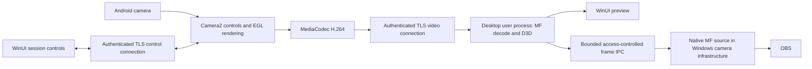

# Camylla living design

Status: living design baseline. The Windows M1 virtual-camera, physical S21 Ultra Android M2 producer, and M3 authenticated transport proofs are recorded in `docs/validation/`. M4 product alpha is current. One phone does not establish broad compatibility.

## 1. Product vision

Provide a free, fully open-source Android-to-Windows webcam for individuals attending video meetings who want better camera quality than their existing webcam. Streaming is secondary. Offer a polished desktop experience inspired by observed DroidCam workflows, with independent code and assets.

## 2. Non-goals

No premium tier, watermark, artificial resolution/FPS limits, accounts, runtime cloud dependency, ads, telemetry or automatic crash uploads in v1. Platforms other than Windows and Android are outside v1. Windows 10 and Windows ARM64 are outside v1. Official releases must function without paid or proprietary companion software; platform OS components/runtimes are distinct from companion products and need redistribution review. Public download hosting is distribution infrastructure, not a runtime dependency.

## 3. Competitive/reference-project analysis

Reference implementations have been inspected at pinned commits; see [source inspection notes](reference-projects.md). Each adopted dependency still requires version/license review before reuse. Project claims are not measured evidence of compatibility or performance.

| Reference | Architectural relevance | Research status |
| --- | --- | --- |
| [DroidCam desktop](https://github.com/dev47apps/droidcam-obs-client) | Actual OBS fork with UI and libobs; study workflows and integration | Public architecture confirmed; Camylla will not reuse OBS shell/libobs |
| [scrcpy](https://github.com/Genymobile/scrcpy/blob/master/doc/develop.md) | Android encoding, separate media/control streams, ADB, host decoding | Apache-2.0 reference; not a ready Windows webcam product |
| [Microsoft virtual camera sample](https://github.com/microsoft/Windows-Camera/tree/master/Samples/VirtualCamera) | Windows 11 software camera and custom media source | Candidate integration reference; target-app proof required |
| [BestCam](https://github.com/OneLimeStudio/BestCam) | MF camera and ADB/MJPEG | Pinned source inspected; incomplete product and permissive IPC; reference only |
| [CatCam](https://github.com/igorfyago/CatCam) | Camera2/MediaCodec, TCP/ADB, MF camera | Pinned source inspected; plaintext transport/permissive IPC; proprietary audio companion excluded |
| [VCamdroid](https://github.com/darusc/VCamdroid) / [Nexora](https://github.com/akashlenvo/Nexora) | DirectShow and phone transports | Pinned source inspected; protocol/versioning lessons; transitive dependencies need independent audits |
| [Android Webcam Project](https://github.com/soubhagyajit/Android-Webcam-Project) | Desktop/virtual-camera integration | Initial GPL-3.0 lead; inspect maturity and dependency boundary |
| [Android system webcam](https://source.android.com/docs/core/camera/webcam) | Some devices can expose a USB UVC webcam without Camylla | Competitive baseline; support is device-dependent |

## 4. Confirmed v1 feature set

- Windows 11 x64 desktop and Android 10+ application (provisional Android support baseline). Windows ARM64 is deferred until native pipeline testing is available.
- One phone, one consuming application as the initial supported case.
- Standalone Windows webcam; an OBS-only source is insufficient.
- Launch compatibility target: OBS. Record its exact version and tested modes with each release.
- Wi-Fi connection, live preview, camera selection, basic image controls, persistent settings, and reliable reconnection.
- Standalone desktop app with its own setup, preview, controls, and settings; no OBS installation or shell. Exact workflows remain open.
- Front/rear selection, orientation, zoom, continuous autofocus, and explicit output mirroring; preview mirroring is a separate setting.
- Expanded #26 scope (user decision, 2026-10-05): a mobile camera interface with tap focus, focus lock/manual focus, torch, exposure/ISO/shutter, white-balance and image controls, framing aids and reusable preferences, exposing only actual supported capabilities. See [camera controls and UX brief](camera-controls-ux.md). These controls are now M4 work rather than deferred features; no hardware or implementation PASS is implied.
- User starts the session from the phone. Continued streaming during app switching and screen-off is required on tested devices, with a visible notification and stop action.
- Reliable 30-FPS operation is the core requirement. 60 FPS is optional, capability-dependent and best-effort; fall back to 30 FPS if unsupported or unsustainable. Failure to deliver 60 FPS does not block v1 or force a more complex architecture.
- Current target phone: Samsung S21 Ultra (supersedes the earlier S20 Ultra statement). Android is reportedly above 10, possibly 13; exact version is unverified.

## 5. Deferred features

All audio (capture, transport, playback, microphone permissions, virtual microphone), USB, multiple phones/scene composition, and recording. Manual focus/exposure, torch and tap-to-focus moved into #26 on 2026-10-05. Unattended remote start and boot-start capture are excluded from v1. OBS fork, libobs embedding, and a Camylla OBS plugin are excluded. No separate receiver service, mandatory cloud service, automatic updater, Store publication, or cross-platform UI requirement. 4K/high-FPS validation is deferred; 60 FPS is optional, not a launch gate. Do not deliberately cap modes proven sustainable on a supported configuration.

## 6. Proposed architecture

Accepted direction: the physical S21 Ultra CameraX to MediaCodec H.264 surface path, Windows M1 Media Foundation camera direction, and M3 authenticated local Wi-Fi receive/decode path passed their initial feasibility proofs. Preview, publication IPC, and product integration are M4 work.

Accepted implementation direction: Kotlin Android app; WinUI 3/C# desktop UI with narrow C++ media/virtual-camera components. One desktop user process owns connections, decoding, preview and settings. No separate Camylla daemon or Windows service in v1. The native virtual-camera source runs in Windows camera infrastructure and receives frames through bounded, access-controlled IPC; it does not host network processing.

The diagram shows responsibility boundaries, not yet finalized socket endpoints or GPU-sharing mechanics. Sharing decoded frames between preview/output is preferred over a second decode path. If CPU copying meets measured targets, do not add complicated GPU IPC solely to achieve a zero-copy label.

## 7. Android architecture

M4.5 implementation update, 2026-10-06: the expanded controls use Camera2 capture requests/results and a shared EGL texture with independent preview and encoder passes. [ADR 0007](adr/0007-camera2-controls-and-separate-preview-rendering.md) records the requirements gap and lifecycle trade-offs. The earlier CameraX proof below remains historical feasibility evidence; this replacement still requires physical camera, cadence, torch and visual acceptance in the [M4.5 matrix](validation/android-windows-m4-5.md).

Capture API evaluation strategy: CameraX first, with Camera2 only for demonstrated requirements gaps. The S21 Ultra physical proof used CameraX `Preview.SurfaceProvider` with a MediaCodec encoder input surface and measured about 29.9 encoded FPS at rear 720p30. CameraX offers lifecycle/control abstractions but requested frame rate is a target; Camera2 offers explicit session/request control with more device-handling work. The CameraX-first direction survived M2. Detailed thermal/battery, other-mode, and device coverage remains later validation. Android 10+ is the provisional minimum, with device/capability testing rather than blanket compatibility promises.

For 60 FPS, intersect per-camera target FPS ranges, encoder-compatible sizes, all output minimum frame durations, and encoder size/rate capabilities, then measure delivered frames. [StreamConfigurationMap](https://developer.android.com/reference/android/hardware/camera2/params/StreamConfigurationMap) and [VideoCapabilities](https://developer.android.com/reference/android/media/MediaCodecInfo.VideoCapabilities) provide relevant capability queries. [Constrained high-speed capture](https://developer.android.com/reference/android/hardware/camera2/CameraConstrainedHighSpeedCaptureSession) is intended for 120+ FPS, not the default 60-FPS path. Android foreground camera-service restrictions must shape session start/resume behavior: [official requirements](https://developer.android.com/develop/background-work/services/fgs/service-types).

Bind capture ownership to the explicit camera session and appropriately started camera foreground service, not merely whether the activity is visible. Request camera permission with an explanation; request no microphone permission. Advertise capabilities rather than assuming every lens supports every control. Pause/report camera loss, revoked permissions and thermal pressure clearly. Exact disconnected-session resource timeouts and lifecycle transitions belong in the session specification before implementation.

## 8. Desktop architecture

The M4.5 control path delegates supported sensor controls and encoded output transforms to the phone; Windows supplies authenticated commands and shows camera-confirmed state. Phone preview mirroring and monitoring aids remain independent of encoded webcam output. This supersedes the original desktop ownership proposal for those transforms below; the current encoder keeps the selected landscape canvas and letterboxes quarter-turn output.

WinUI 3/C# with narrow native C++ media components accepted, conditional on deployment and preview-integration validation. Alternatives: WPF (mature tooling, less Windows App SDK coupling); WinUI 3/C++/WinRT (fewer languages, more XAML/WinRT complexity); Qt/C++ (mature widgets/common language, deployment and Windows styling effort). Windows-only v1 removes cross-platform UI as a requirement. Selection prioritizes native Windows appearance and keeping UI logic out of the media implementation, rather than familiarity with a framework.

One desktop user process owns connections, decode, preview and settings; no separate Camylla daemon/service. C++ camera source remains small and runs in Windows infrastructure. Exact ABI, D3D preview integration, source-to-receiver IPC, frame formats, access-control identities, and resource lifetimes require design/proofs. Window close minimizes to tray while streaming; explicit Exit stops streaming. Recovery keeps the webcam available with a neutral disconnected frame and retries with capped backoff for the life of the active phone-started session. Explicit Stop cancels recovery. M4 defines the visible manual-retry and error UX.

Accepted decoder evaluation: inbox Media Foundation H.264 decoder with [D3D11 acceleration](https://learn.microsoft.com/en-us/windows/win32/medfound/supporting-direct3d-11-video-decoding-in-media-foundation) before bundling FFmpeg. GPU acceleration is device-dependent and needs measured fallback behavior. Decode, display, and virtual-camera publication are distinct responsibilities.

The single-phone desktop workflow is pair/connect, verify preview, select supported camera/mode, then select Camylla in the meeting application. Surface connection state and actionable permission/firewall errors. Keep detailed diagnostics outside the primary setup flow. Persist camera choice, preferred mode, transform settings and trusted identities; never persist an active capture authorization across explicit Stop. Values must be revalidated when devices/capabilities change.

## 9. Streaming protocol and transports

Wi-Fi confirmed; USB deferred. TLS/TCP is the accepted evaluation target, not a proven final transport. ADB is an architectural reference for later USB work: [scrcpy connection documentation](https://github.com/Genymobile/scrcpy/blob/master/doc/connection.md). Its debugging/trust setup is a consumer-UX trade-off, while Android Open Accessory would require separate hardware-support and Windows USB integration work; neither is needed in v1.

Alternatives considered:

| Candidate | Benefit | Cost/risk |
| --- | --- | --- |
| Separate TLS/TCP control and video connections | Small integration surface using platform TLS; control is isolated from video backlog | Ordered video retransmission can delay fresh frames; bounded queues cannot remove bytes already in flight; requires measured reset/refresh behavior |
| WebRTC with local signaling | Existing secured real-time media, loss/congestion handling | Larger native integration/build surface; ICE/signaling still required even without cloud services |
| QUIC streams/datagrams | Shared authenticated transport and datagram option | Reliable video stream still has within-stream blocking; datagrams require media fragmentation/pacing/recovery design |

Sources: [TCP](https://www.rfc-editor.org/rfc/rfc9293.html), [streaming transport considerations](https://www.rfc-editor.org/rfc/rfc9317.html), [WebRTC transports](https://www.rfc-editor.org/rfc/rfc8835.html), [QUIC DATAGRAM](https://www.rfc-editor.org/rfc/rfc9221.html). The M3 physical proof accepts separate TLS/TCP control/video connections for continued development: 720p30 decoding sustained, queues were bounded, and receiver restart and Wi-Fi interruption recovered. This is not a release latency or impairment-profile pass; revisit the transport only if concrete later evidence defeats requirements. The implemented v2 framing is specified in [protocol-v2.md](protocol-v2.md). Arbitrary H.264 dependent-frame dropping is unsafe; recover through a fresh sync frame and correct decoder reset. Android supports [sync-frame requests](https://developer.android.com/reference/android/media/MediaCodec), without promising immediate fulfillment.

[Android NSD](https://developer.android.com/develop/connectivity/wifi/use-nsd) provides DNS-SD discovery, which must be treated as untrusted. Current/future Android targets introduce [local-network permission requirements](https://developer.android.com/privacy-and-security/local-network-permission), so minimum Android version does not remove permission maintenance obligations. Accepted pairing workflow: phone scans a desktop QR conveying a short-lived endpoint and verified identity/one-time high-entropy capability. Manual address entry may replace the endpoint hint, but still requires the same QR or manually transcribed high-entropy authorization and desktop fingerprint. The proposed [production pairing protocol](pairing-protocol-v3.md) defines endpoint roles, identity, expiry, rotation, and the fallback contract. Windows inbound firewall treatment and physical fallback UX remain M4 implementation/validation work. A short PIN alone is not accepted as authorization.

Production trust direction for M4: a phone user explicitly starts first pairing and scans a desktop QR carrying the desktop identity and a short-lived, single-use, high-entropy authorization. Manual endpoint entry may locate a desktop but still requires the same explicit authorization and authenticated identity check. Expired or consumed authorizations cannot be replayed; pairing attempts are rate-limited. After acceptance, each side stores only the credentials needed for a remembered, named peer, protected by Android Keystore and Windows user-scoped platform credential protection. Both sides expose trust revocation; revocation invalidates future session authentication, and replacement/rotation requires a new explicitly authorized exchange or an authenticated rotation confirmed by the phone user. A fresh authenticated control session uses a new unpredictable session ID; the video bind must prove the same peer identity and session, and old IDs cannot be rebound. A trusted desktop receives video only while a phone-user-started capture session is active; Stop cancels recovery and session authorization. [The v3 proposal](pairing-protocol-v3.md) specifies credentials, TLS proof, expiry, storage APIs, and revocation/rotation wire behavior for review before implementation. The current development pin and secret do not implement this workflow.

The implemented [v2 wire specification](protocol-v2.md) defines bounded message lengths and allocations, capability exchange, selected mode, configuration generation, timestamp units/clock domains, sequence numbers, control responses/errors, and reconnect/reset rules. Unsupported major versions are rejected. Both sockets bind to one authenticated session; a discovered address is not identity. Video from an old configuration must not be decoded as the current configuration. Do not subtract unrelated phone/PC clocks to claim end-to-end latency.

## 10. Video pipeline

H.264-only v1 accepted, with MediaCodec hardware encoding where available. HEVC/AV1 and bundled FFmpeg require a concrete demonstrated need before reconsideration. Validate 720p30/1080p30 on the supported matrix. Optionally evaluate 720p60/1080p60 on the S21 Ultra; expose sustainable modes and automatically fall back to 30 FPS when needed. Lack of 60-FPS support does not block release. Prefer proven surface/hardware paths over CPU pixel conversion or a new software encoder; any fallback must pass the same baseline tests.

Accepted targets: camera-to-OBS latency <=200 ms at p95 on a defined healthy LAN and stable streaming verified through focused functional and recovery checks, without a minimum test duration. Camera capture, encoder, transport, decoder, and consuming application must support the negotiated mode; recording specifications alone are insufficient evidence. The consuming application selects its capture format; advertising 60 FPS does not force it to consume 60 FPS. No artificial caps does not mean promising unsupported hardware modes.

Accepted adaptation policy: selected quality is a target. The current M4.7 implementation reduces encoder bitrate to 75% of the selected profile during network recovery or severe thermal pressure, then restores it after pressure clears. It reports selected/effective values, delivered FPS and one current reason. It keeps resolution, FPS target and the consumer's negotiated output format stable for that bitrate-only adaptation. Mode changes use a new generation and fresh keyframe. Measurements may justify a later deliberate resolution/FPS adaptation for sustained performance or thermal pressure. Thermal safety overrides quality preference. Engineering recommendation: preview/virtual output share decoded frames where feasible rather than independently decoding the stream. Exact thresholds and copy/GPU strategy remain proof-dependent.

Desktop transforms own rotation, output mirroring and scaling. Preview mirroring is independent. Keep the negotiated Windows output format stable during an active consumer session, reconfigure Android deliberately, and resume from a fresh keyframe. If output cadence duplicates lower-rate captured frames, report actual distinct capture/delivery FPS rather than counting duplicates as successful 60 FPS. Handle color range/matrix and aspect ratio explicitly to avoid wrong colors or stretched output. Initial bitrate profiles, maximum wire access-unit size, queue-age/byte budgets, HDR exclusion/SDR handling and CPU/GPU copy policy must be specified and measured before implementation; they are not marketing guarantees.

## 11. Audio strategy

All audio work is outside v1: no capture, transport, playback, microphone permissions, or virtual microphone. Users retain their existing microphone. Future audio must be designed as a complete feature with endpoint installation, synchronization, routing, and licensing decisions.

AudioRecord capture is only one part of that feature. A Windows camera API does not supply a virtual microphone; a virtual audio endpoint may require a separate driver/signing/distribution strategy or another integration. Avoid a proprietary virtual-cable requirement. Audio sync, clock drift, echo processing and buffering are future design work, not hidden placeholders in v1's protocol.

## 12. Windows virtual camera strategy

Accepted proposed architecture: Windows 11 Media Foundation software camera, conditional on OBS validation. DirectShow and kernel-driver paths deferred unless a demonstrated requirement defeats this approach. [MFCreateVirtualCamera](https://learn.microsoft.com/en-us/windows/win32/api/mfvirtualcamera/nf-mfvirtualcamera-mfcreatevirtualcamera) requires build 22000+, supports current-user/all-user access scopes, and requires admin for all-user access. [Microsoft sample](https://github.com/microsoft/Windows-Camera/blob/master/Samples/VirtualCamera/README.md) demonstrates a custom media source and installer. Camera registration scope and media-source COM deployment are separate privilege questions: current-user camera scope alone does not prove a no-admin installer.

The source advertises explicit sizes, pixel formats and frame rates; test NV12 and a suitable legacy-consumer fallback such as YUY2 rather than assuming one subtype covers all applications. Prefer the smallest passing format set. Accepted UX target: a persistent camera registration for the current Windows user remains selectable when the desktop receiver is closed/unavailable and produces neutral offline output. Opening the camera never remotely starts phone capture. Verify the API lifetime, activation and deployment behavior in the Windows proof; native source installation may still require elevation. During receiver loss the source must deliver neutral offline output safely, without stale images, unbounded waiting or network processing. Separate application signing from kernel-driver signing: v1 does not deliberately introduce a kernel camera driver.

## 13. OBS/libobs investigation and conclusion

Modern DroidCam is an [OBS Studio fork](https://github.com/dev47apps/droidcam-obs-client), containing OBS UI and libobs trees; its [UI build file](https://github.com/dev47apps/droidcam-obs-client/blob/droidcam-720/UI/CMakeLists.txt) uses Qt. This establishes actual OBS/Qt reuse. A standalone product can use OBS internally: the vendor's [Windows setup](https://droidcam.app/windows/) presents an independently installed client and a regular webcam output. Its current workflow includes adding a DroidCam source and refreshing discovered devices. Camylla will instead provide its own single-phone setup, preview, controls, and settings.

Accepted conclusion: omit libobs, an OBS fork, and a Camylla OBS plugin from v1. Single-phone output does not require scenes, composition, recording, or broadcast management; the extra engine/dependency surface lacks a confirmed requirement. OBS remains a reference and consuming application. Qt remains an independent UI alternative. Reconsider engine reuse only for a concrete unmet requirement. Public source does not establish that every DroidCam component is public.

## 14. Security/privacy model

Local operation, no account/runtime cloud dependency, no telemetry or automatic crash uploads in v1. Require encrypted/authenticated local connections, explicit first pairing, remembered trust, and trust revocation. A trusted desktop may connect only during an active session started by the user on the phone; discovery grants no camera access. Internet access, relays, and router port forwarding are outside v1.

Threats in scope: unauthorized LAN peers, impersonation/replayed pairing attempts, malformed messages/media, unbounded resource use, and unauthorized IPC frame reads/writes. Protect both media/control identity bindings, pair only through a short-lived user-visible action, rate-limit pairing, and review credential storage/rotation. Use platform key protection; specify the ACL/service identity arrangement for IPC before implementation. Never inherit NULL-DACL shared memory from references. Desktop network exposure should be constrained to the intended local-network workflow, not quietly enabled for public networks.

Windows camera permissions govern consuming applications. A compromised phone or Windows installation is outside the protection boundary; so is preventing an authorized consumer from recording received pictures. Diagnostics remain local, bounded and free of pictures, secrets and keys; export is explicit and reviewable. No media recording/cache feature. Explicit Stop invalidates recovery authorization. Exact protocol limits, credential persistence and pairing fallback UI need a written/reviewed specification.

## 15. Dependency and licensing analysis

GPL-3.0-or-later selected for Camylla's own code, subject to an audit of distributed dependencies. Prefer compatible permissive dependencies. GPL-2.0 reference code remains reference-only until exact upgrade/compatibility permissions are established. Official releases must not require paid/proprietary companion software.

| Candidate | Observed source license | Distribution action |
| --- | --- | --- |
| CameraX/AndroidX | Apache-2.0 | Pin actual artifacts; preserve notices |
| ZXing QR decoder, if used | Apache-2.0 | Verify artifact/version and wrappers separately |
| WinUI/Windows App SDK | MIT source | Audit actual NuGet/runtime artifacts and notices |
| .NET | MIT source; distinct Windows product-distribution terms | Audit apphost, runtime packs and self-contained bundle terms |
| Microsoft Windows-Camera sample | MIT source | Pin revision; retain notices if adopting code |
| OS MediaCodec/MF/D3D/TLS APIs | Platform APIs | Platform support/redistributables are separate from Camylla source license |
| OBS/libobs and Qt | Not selected | No v1 dependency; independent references only |

See [inspection/licensing sources](reference-projects.md). Root source licenses do not establish the terms of every shipped binary. Audit exact runtime packages, VC runtime redistribution, installer tool/output, codecs, attribution and source obligations at pinned versions before release. H.264 software copyright licensing and potential patent obligations are distinct; native codec use does not justify asserting all distribution obligations are resolved. Resolve package/signing eligibility as a release gate, revisiting dependency packaging if necessary rather than quietly abandoning the copyleft objective.

## 16. Installer/distribution strategy

Initial distribution: conventional Windows x64 installer and release-signed Android APK via GitHub Releases. Runtime use remains offline/local. Accept one explained installation elevation for media-source registration/runtime deployment; normal operation is unprivileged. Validate offline installation on a clean Windows 11 machine, clean uninstall, upgrades and removal of camera registrations. Provide clear firewall/permission explanations. Do not require users to assemble developer tools or install OBS.

Manual updates only, no automatic network checks. Defer automatic updater, Microsoft Store, Google Play and F-Droid publication. APKs use a maintained release signing identity, never the debug key. Preserve update compatibility and back up signing credentials. Store and direct APK channels may need distinct signing/update plans later.

Target trusted signing for official Windows v1 releases; unsigned development builds must be clearly labelled. Signing identity/provider, eligibility, funding and key custody remain unresolved release risks. [Microsoft options](https://learn.microsoft.com/en-us/windows/apps/package-and-deploy/code-signing-options) and [SignPath conditions](https://signpath.org/terms.html) are references, not secured arrangements. Signing does not itself promise no SmartScreen prompt. A cloud signing/build service, if used, is release infrastructure and not a runtime product requirement. Installer technology and exact offline runtime bundle remain proof/audit decisions; do not select WiX/Inno Setup purely from habit.

## 17. Testing strategy

Launch gates cover OBS on recorded versions; supported 30-FPS modes; <=200-ms p95 camera-to-OBS latency on a documented healthy LAN; and streaming, bounded resources and recovery verified through focused functional checks. No minimum test duration applies. 60 FPS is optional and its absence is not a release failure. Remote meeting-server/transmission latency is outside this local pipeline target.

Test hardware: S21 Ultra first, then a second phone and a Windows x64 integrated-GPU configuration before broad support claims. Exact devices/Windows CPU/GPU and Android version remain unknown. Emulator results do not establish physical camera/codec behavior.

Test groups:

- Synthetic source and protocol tests: length/version/configuration validation, malformed input, truncated frames, decoder refresh, bounded memory, control acknowledgment, paired identity binding and state transitions.
- Android physical tests: front/rear capture, controls/capability gating, orientation, screen-off/app switch, revoked permissions, camera interruptions, charging versus battery, thermal adaptation and battery drain.
- Windows physical tests: camera enumeration/activation/format negotiation, preview/output correctness, consumer start/stop/restart, receiver exit/crash, permissions, low-end GPU/CPU fallback and stable offline frames.
- Network impairment: packet loss, jitter, bandwidth reduction, Wi-Fi/IP changes and a 20-second disconnect. Require bounded backlog/memory, neutral disconnected output, and measure recovery against the five-second target after usable connectivity returns. An explicit phone-started capture keeps retrying with capped backoff until Stop. Record test parameters and results; use concrete failures to reassess TCP.
- Distribution: clean offline installation with ordinary UAC, upgrade, runtime dependencies, signature verification, uninstall and stale camera/registry cleanup.

Define the healthy-LAN fixture, impaired-network profiles, measurement duration/sample count and optical/test-consumer latency method before the proofs. Do not treat unsynchronized timestamp subtraction as end-to-end measurement. Record battery/thermal measurements before making consumption claims. Numeric initial bitrate and buffer thresholds are experimental configuration, not silently assumed requirements.

## 18. CI/CD strategy

Build Android and Windows separately in CI. Pin SDK/toolchain/dependencies and use documented runner images; hosted images themselves still change, so record build provenance rather than promising byte-identical outputs without evidence. Check parser/versioning, pairing/reconnection state transitions and synthetic media flow. Android emulator lifecycle/permission smoke tests complement physical tests.

Generate dependency notices, source references and release checksums; audit actual bundled artifacts. Prefer repeatable clean builds with recorded provenance; assess bit-for-bit reproducibility separately, excluding signing timestamps. Keep private keys/signing credentials away from untrusted PRs. Release signing is a protected, explicitly approved workflow; physical compatibility/performance and install/UAC tests are separate release evidence. Cloud Windows CI often runs with elevated privileges and cannot prove ordinary installation behavior. Use a hardware test checklist/versioned result artifact until there is capacity for dedicated hardware automation.

## 19. Major technical risks

- Windows virtual-camera/consumer compatibility, source deployment and WinUI/native preview integration. Prove these before the complete UI.
- CameraX-to-encoder suitability, device diversity and camera foreground-service lifecycle. Prove core 30-FPS behavior first; 60 FPS can fall back.
- TCP head-of-line delay and sustained stale-video backlog. Bounded queues/reconnect are hypotheses until impairment tests pass; WebRTC is the fallback architecture.
- Sustained encoding heat, battery use, Android background restrictions and GPU/CPU fallback. Measure charging/screen-off cases rather than inferring from short recordings.
- IPC identity/ACL mistakes, credential rotation and malformed protocol inputs. Reference implementations are not security authority.
- Actual bundled-runtime licensing, signing eligibility/funding and ordinary offline installation. These remain release risks even when source repositories are open.
- One-maintainer capacity and unknown test hardware/budget. No promised date or unlimited hardware support.

## 20. Open questions

Remaining factual unknowns: current S21 Ultra Android version; Windows CPU/GPU/version; actual maintainer hours; second phone/test-machine access; release/signing budget and responsible key owner. No delivery dates are assumed.

Remaining empirical/design-detail questions, to resolve before their implementation milestone:

1. Can CameraX satisfy baseline capture/controls/lifecycle on the hardware matrix? Optional 60 FPS never blocks a passing 30-FPS baseline.
2. Do MF source activation/format negotiation and WinUI preview work across target applications, including failure/exit? Which source scope/lifetime and deployment model pass the required UX?
3. Does TLS/TCP pass later measured camera-to-consumer latency and broader impairment gates? M3 accepts it for continued development, subject to concrete later evidence.
4. What are measured bitrate operating profiles, queue limits, access-unit bounds, thermal thresholds and CPU fallback modes?
5. Does the proposed [v3 pairing/key-rotation specification](pairing-protocol-v3.md) pass security and implementability review, and does its manual-address fallback pass physical UX validation?
6. Which IPC mechanism, service/user identity ACL and frame-copy strategy meet security/performance requirements?
7. Which artifact/runtime licenses, offline installer tool, trusted signing provider and release-key practices pass distribution review?
8. Which exact healthy/impaired network fixtures and latency measurement setup will produce reviewable evidence?

These remain proof/specification questions rather than claims of broad compatibility. Final interview review confirmed the narrowed v1 scope and persistent current-user webcam UX. The M1, M2, and M3 evidence is recorded separately; full camera-to-consumer latency and broader impairment measurements remain later gates.

## 21. Milestones from proof-of-concept to v1.0

Sequence accepted; dates deliberately unset. M0, Windows M1, physical S21 Ultra M2, and the M3 transport feasibility proof are complete. M4 product alpha is current.

| Milestone | Work | Exit evidence |
| --- | --- | --- |
| M0: design baseline | Review scope, glossary, ADRs, protocol/pairing outlines and available test resources | Shared understanding; explicit unknowns and proof responsibilities |
| M1: Windows feasibility | Synthetic MF source, target consumers, install/uninstall and native preview/WinUI deployment | OBS can consume core modes; workable deployment/IPC seam; documented source lifetime behavior |
| M2: Android feasibility | CameraX/MediaCodec H.264, basic controls and explicit service lifecycle on S21 Ultra | Rear 720p30 produced about 29.9 encoded FPS and fully decodable H.264; lifecycle paths manually exercised; detailed other-mode and thermal/battery measurements remain later validation |
| M3: secure end-to-end transport | Versioned protocol and production trust direction; TLS/TCP physical proof | Authenticated 720p30 decode, bounded queues, receiver restart and Wi-Fi recovery; TLS/TCP accepted for continued development; exact latency/recovery timing remains a later measured gate |
| M4: product alpha | Focused setup, preview/controls/settings, errors, recovery and degradation UX | Complete first-use/repeat-use flows; no silent stale output or unsupported-control failures |
| M5: wider alpha/beta | Second phone/integrated-GPU matrix; parser/security, runtime/license and packaging reviews | Recorded OBS compatibility and functional streaming/recovery results; ordinary offline install/upgrade/uninstall; release signing path established |
| M6: v1.0 | Protected release, signed distribution, notices/checksums, documented support/limitations | All core 30-FPS release gates pass; reproducible procedure/provenance, known limitations and rollback/reinstall instructions |

Stop and revisit the relevant ADR when a proof fails; do not compensate for missing core reliability by accumulating features. USB/audio may receive later, separate design sessions after baseline reliability.

## 22. Architecture Decision Records to create

Recorded ADRs:

- [0001: user-started camera sessions](adr/0001-user-started-camera-sessions.md).
- [0002: Windows 11 software camera](adr/0002-windows-11-software-camera.md).
- [0003: standalone client without OBS engine](adr/0003-standalone-client-without-obs-engine.md).
- [0004: Windows UI and narrow native media boundary](adr/0004-windows-ui-and-native-media-boundary.md).
- [0005: evaluate authenticated TLS/TCP before a larger media stack](adr/0005-authenticated-lan-transport-evaluation.md).
- [0006: copyleft source and audited distribution](adr/0006-copyleft-and-distribution-audit.md).

Create further ADRs when the capture API, final transport, reviewed pairing identity scheme, IPC/source lifetime, installer/runtime distribution and release signing choices crystallize through real trade-offs. Optional 60 FPS with 30-FPS fallback is a scope decision captured here, not a reason to add architectural machinery. Future USB/audio decisions need their own ADRs if pursued.
